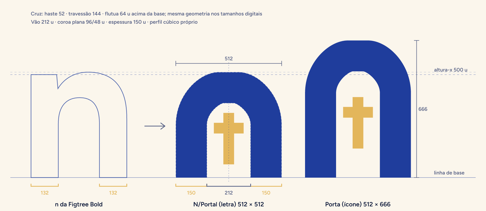
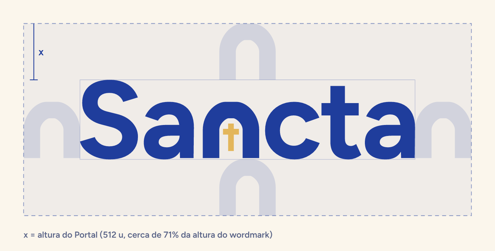

# Manual da marca Sancta — "Portal"

> Vitrine visual de todos os assets: `brand/index.html` (sirva a raiz do projeto, por exemplo
> `php -S 127.0.0.1:8010 -t .`, e abra `/brand/index.html`). Todos os arquivos são gerados por
> `brand/source/build-brand.js` (ver [Como regenerar](#13-como-regenerar)).

## 1. Ideia

Sancta é o lugar onde a pessoa entra para rezar, todos os dias. O símbolo é a **porta de um santuário**,
com a **cruz como a luz lá dentro**. O arco nasce do **"n" da Figtree Bold** — mesma haste, mesma curva —
por isso o símbolo mora dentro do próprio nome: `Sa[portal]cta`. No app, **o arco vira moldura** para
imagens e orações: a marca está em cada tela.

## 2. Construção do Portal



Unidades = unidades da fonte Figtree Bold (1000 por em). Linha de base em 0, altura-x 500, overshoot 512.

| Elemento | Medida | Origem |
|---|---|---|
| Hastes | 132 u | iguais às hastes do "n" (57→189 e 388→520) |
| Arco externo | semicírculo de raio 243 u (largura 486 u), centro em 269 u | topo no overshoot do "n" (512 u) |
| Abertura | semicírculo de raio 111 u (vão de 222 u), centro em 284 u, topo em 395 u | espessura no alto = 117 u (89% da haste): a mesma compensação óptica dos arcos da Figtree (no "n": 124 u) |
| Cruz (Ouro) | hastes de 58 u; travessão de 150 u entre 207 e 265 u; vertical de 55 a 317 u | travessão no terço superior; a cruz flutua 55 u acima da base, como nas imagens aprovadas |
| Porta (ícone) | mesmo arco com as hastes alongadas 154 u → 486 × 666 u; cruz de 111 a 405 u, travessão 285–343 u | proporção vertical do mockup |
| No wordmark | o Portal ocupa o lugar do "n", centrado no olho do n | ajuste óptico medido na referência: S→a −18 u, c→t −18 u, t→a −15 u (além do kerning da fonte) |

As mesmas coordenadas estão em `brand/source/portal.js` (masters SVG/Android) e em
`app/lib/core/brand/portal_geometry.dart` (`PortalGeometry`) — um teste (`app/test/brand_test.dart`)
garante que continuam iguais.

> Decisão: o brief pedia "haste vertical até a linha de base", mas as imagens aprovadas pelo cliente
> mostram a cruz flutuando ~1 espessura acima da base. Seguimos as imagens aprovadas: a cruz solta lê
> melhor como "luz dentro da porta" e não divide a abertura em duas frestas nos tamanhos pequenos.

## 3. Área de proteção e tamanhos mínimos



- **Área de proteção = altura do Portal (x)** em volta do wordmark (≈ 71% da altura do wordmark) e em volta
  do símbolo isolado.
- **Tamanhos mínimos**
  - Wordmark: 16 px de altura (≈ 67 px de largura) na tela; 5 mm de altura impresso.
  - Símbolo (Portal): 16 px de altura. Em fundos claros abaixo de 24 px, prefira a versão mono (a cruz
    Ouro tem pouco contraste sobre Pergaminho).
  - Ícone do app: validado em 29 px (ajustes). Favicons 16/32/48 px têm desenho próprio alinhado à grade
    de pixels (Portal maior no quadro e cruz mais encorpada).
  - Notificação: 24 dp, desenhada na grade de 24 com área útil de 20 dp.

## 4. Cores

| Token | Hex | Uso | Contraste (WCAG) |
|---|---|---|---|
| **Azul Manto** | `#1F3D9C` | principal: marca, botões, links, navegação ativa | Pergaminho sobre ele 8,84:1 · ele sobre branco 9,52:1 |
| **Noite** | `#132760` | fundos escuros, superfícies do tema escuro | Pergaminho sobre ele 13,11:1 |
| **Tinta** | `#0E1A3A` | texto; fundo mais profundo do tema escuro | sobre Pergaminho 15,88:1 |
| **Ouro** | `#E3B65B` | **só a cruz e destaques pequenos** (selo Sancta+, sequência) | sobre Azul Manto 5,04:1 · sobre Tinta 9,05:1 · **sobre Pergaminho 1,76:1 (nunca texto/ícone informativo em fundo claro)** |
| **Pergaminho** | `#FBF6EC` | fundos claros; texto e marca sobre azul | — |

Derivações permitidas (em `BrandColors`):

| Nome | Hex | Uso | Contraste |
|---|---|---|---|
| Branco | `#FFFFFF` | cartões sobre Pergaminho | — |
| Névoa | `#C8D5FF` | texto secundário sobre Azul Manto (slogan, datas no widget) — medido no mockup | 6,54:1 sobre Azul Manto |
| Tinta suave | `#5A6487` | texto secundário em fundo claro — medido no mockup | 5,40:1 Pergaminho · 5,82:1 branco |
| Tinta apagada | `#7C849C` | ícones inativos (mínimo 3:1) | 3,46:1 Pergaminho · 3,73:1 branco |
| Véu azul | `#E8ECF8` | fundo de ícone (~10% de Azul Manto) | Azul Manto sobre ele 8,06:1 |
| Azul Luz | `#9DB2FF` | Azul Manto clareado para o tema escuro (links, aba ativa) | 8,35:1 Tinta · 6,89:1 Noite |
| Erro | `#B3261E` / escuro `#F2B8B5` | vermelho funcional | 6,54:1 branco / 10,02:1 Tinta |
| Sucesso | `#1E7A4C` / escuro `#7DD3A0` | verde funcional | 5,33:1 branco / 9,53:1 Tinta |
| Tingido | `#111111` · `#DADADA` · `#9B9B9B` | ícone monocromático (fundo · arco · cruz) | — |

Ilustrações de céu usam uma paleta própria de degradês (lilás, rosa, pêssego, âmbar) — **não** são cores
de marca para interface.

## 5. Tipografia

- **Figtree** (SIL OFL 1.1), estática, embutida:
  - App: `app/assets/fonts/Figtree-{Regular,Medium,SemiBold,Bold,ExtraBold}.ttf` → família `Figtree`
    (pesos 400/500/600/700/800 no `pubspec.yaml`).
  - Site: `backend/public/fonts/figtree/*.woff2` (latin + latin-ext, 400–800) + `backend/public/fonts/figtree.css`
    (`font-display: swap`, `unicode-range`). Uso: `<link rel="stylesheet" href="/fonts/figtree.css">`.
  - Bold 700 para marca e títulos · Medium 500 para interface · Regular 400 para texto corrido · SemiBold 600 opcional.
- **EB Garamond** 400/500 (OFL), família `EB Garamond`: opção de leitura "Clássica" (Bíblia/orações).
- **Cormorant Garamond é proibida** (acentos quebram no Flutter).
- Acentuação validada no Flutter (teste de renderização com `FontLoader` + golden, 2026-10-04): "Bom dia,
  você · oração · ação · São José · Fé · Amém · Ó Maria" e `ê ç ã õ é ú í â à ü` em todos os pesos de
  Figtree e EB Garamond — acentos e cedilhas na posição correta.
- Licenças: `app/assets/fonts/OFL-*.txt` (registradas na tela de licenças por `registerBrandFontLicenses()`)
  e `backend/public/fonts/figtree/OFL.txt`. Origem: arquivos oficiais do Google Fonts (`fonts.gstatic.com`,
  SHA-256 conferido com o pacote `google_fonts`) e `@fontsource/figtree` 5.3.0 (npm).

## 6. Símbolo e logotipo

| Versão | Uso |
|---|---|
| Pergaminho + cruz Ouro | sobre Azul Manto, Noite, Tinta |
| Azul Manto + cruz Ouro | sobre Pergaminho e branco |
| Mono branco / mono Tinta | fotos, impressão a uma cor, fundos neutros — **arco e cruz na mesma cor** |

- **Wordmark** "Sa" + Portal + "cta" em Figtree Bold convertida em curvas (`brand/logo/sancta-wordmark-*.svg`).
- **Lockup com slogan** ("Sua jornada de fé, todos os dias." em Figtree Regular, corpo = 0,148 do em do
  wordmark, centrado, linha de base 394 u abaixo da do wordmark; Névoa sobre azul, Tinta suave sobre claro).
- **Sancta Gestão** (painel): wordmark + fio vertical + "Gestão" em Figtree SemiBold discreto
  (`sancta-gestao-claro.svg` para fundo claro, `sancta-gestao-escuro.svg` para fundo escuro).
- **Por que não "silhueta com cruz vazada"?** Testamos a porta cheia com a cruz recortada: em tamanho
  pequeno ela lê como **lápide**. Por isso as versões mono (e o ícone de notificação) mantêm a porta aberta
  com a cruz na mesma cor — opção que o brief também prevê ("cruz vazada ou na mesma cor").

## 7. Ícone do app

- A mesma porta em **proporção vertical** (486 × 666 u), com 59,5% da altura do quadro, centrada.
- Versões: **Padrão** (fundo Azul Manto), **Escuro** (fundo Tinta), **Tingido** (cinzas `#111/#DADADA/#9B9B9B`).
  Masters 1024 px em quadrado cheio (`brand/app-icon/`): as plataformas aplicam a máscara.
- **Android**
  - Adaptativo (`mipmap-anydpi-v26/ic_launcher.xml` e `ic_launcher_round.xml`): fundo `@color/ic_launcher_background`
    (Azul Manto, em `values/ic_launcher_colors.xml`), primeiro plano vetorial
    `@drawable/sancta_portal_launcher_foreground` (Portal com 42,84 dp de altura, dentro da zona segura de 66 dp)
    e **ícone temático** (Android 13+) `@drawable/sancta_portal_launcher_monochrome` (arco 100%, cruz 55% de alfa,
    como o "Tingido").
  - Legado (API < 26): `mipmap-*/ic_launcher.png` (quadrado arredondado) e `ic_launcher_round.png` (círculo),
    48/72/96/144/192 px.
  - `mipmap-*/ic_launcher_foreground.png` foi mantido com a arte nova só porque os estilos de splash v31 ainda
    apontam para `@mipmap/ic_launcher_foreground` (Motion deve trocar para `@drawable/sancta_portal_splash`).
  - Notificação: `drawable/ic_notification.xml` (vetor branco 24 dp; o sistema aplica a cor de destaque —
    use Azul Manto `#1F3D9C`). Os PNG antigos `drawable-*/ic_notification.png` foram removidos.
  - Splash/widget: `drawable/sancta_portal.xml` (Pergaminho + Ouro), `drawable/sancta_portal_mono.xml`
    (branco, tingível com `android:tint`), `drawable/sancta_portal_splash.xml` (288 dp para
    `windowSplashScreenAnimatedIcon`, Portal de 110 dp dentro do círculo de 192 dp) e `drawable/splash_logo.png`
    (mesmo nome usado por `launch_background.xml`, arte nova).
- **Web**: `favicon.svg` e `favicon-16/32/48.png` (desenho alinhado à grade), `/favicon.ico` (16+32+48),
  `apple-touch-icon.png` 180 (quadrado cheio), `icon-192/512.png` (cantos arredondados), `icon-maskable-512.png`
  (quadrado cheio, conteúdo dentro da zona segura de 80%), `/site.webmanifest`.
- **Play Store**: `brand/play-store/icone-512.png` (quadrado cheio) e `feature-graphic-1024x500.png`.

## 8. Ilustrações (céus em arco)

| Céu | Quando | Arquivo |
|---|---|---|
| Aurora | 05h–11h59 (Azul Manto → lilás → pêssego/âmbar, sol Pergaminho) | `aurora.svg` |
| Luz | 12h–15h59 (claro e neutro, raios suaves) | `luz.svg` |
| Entardecer | 16h–18h59 (violeta → rosa → laranja, sol se pondo, faixas de nuvem) | `entardecer.svg` |
| Noite | 19h–04h59 (Tinta → Noite → Azul Manto, lua crescente, estrelas, um brilho Ouro) | `noite.svg` |

- Paisagem 1200 × 800 (cartões, site) e retrato 600 × 800 (`*-retrato.svg`, widget e molduras altas), em
  `brand/illustrations/`, `backend/public/images/illustrations/` e `app/assets/brand/ceu_*.svg`.
- Composição pensada para a moldura em arco: sol/horizonte ancorados na base, elementos dentro do semicírculo.
- No app use `SkyArt` (desenhado em código, adapta-se a qualquer proporção) — `SkyArt.forTime(DateTime.now())`.
- Só formas e degradês (sem filtros), compatível com `flutter_svg` e navegadores.

## 9. O arco como moldura

Imagens de orações, jornadas e destaques têm **topo em semicírculo (raio = largura ÷ 2)** e base reta (ou
levemente arredondada). No app: `ArchFrame` / `ArchClipper` (`app/lib/core/brand/arch_frame.dart`). No site:
`border-radius: 999px 999px 0 0` numa caixa com `overflow: hidden` (ou `clip-path`).

## 10. Ícones de postura litúrgica

`de_pe`, `maos_postas`, `de_joelhos`: formas cheias e arredondadas numa grade de 24, uma cor só (o app tinge
com a cor primária via `Image.asset(color: …)`). PNG 256 px transparentes com os **mesmos nomes** em
`app/assets/images/` + SVG em `brand/icons/posturas/` e `app/assets/brand/postura_*.svg`.
(Os PNG antigos tinham fundo amarelo, que virava um quadrado sólido ao ser tingido.)

## 11. O que não fazer

- Não distorcer, girar, inclinar, contornar, aplicar sombra, brilho, degradê ou textura na marca.
- Não trocar as cores do Portal (a cruz é sempre Ouro, ou a cor única na versão mono).
- Não usar Ouro em grandes áreas, nem como texto sobre fundo claro.
- Não recompor o wordmark com outra fonte nem digitar "Sancta" em Figtree no lugar do arquivo.
- Não colocar a porta cheia com cruz recortada (lê como lápide).
- Não usar Azul Manto sobre Noite/Tinta para textos (contraste baixo) — use Pergaminho ou Azul Luz.
- Não invadir a área de proteção; não usar abaixo dos tamanhos mínimos.
- Não usar Cormorant Garamond.

## 12. Arquivos e onde são usados

| Caminho | Conteúdo | Usado por |
|---|---|---|
| `brand/symbol/portal-{pergaminho,azul,mono-branco,mono-tinta}.svg` (+ `png/`) | símbolo | todos |
| `brand/logo/sancta-wordmark-*.svg`, `sancta-lockup-slogan-*.svg`, `sancta-gestao-{claro,escuro}.svg` (+ `png/`) | logotipos | site, painel, materiais |
| `brand/app-icon/icone-{padrao,escuro,tingido}.svg` (+ `png/` 1024), `icone-padrao-arredondado.svg` | ícone | lojas, iOS (pendente) |
| `brand/illustrations/*.svg` (+ `png/`) | céus | site, app, widget |
| `brand/icons/posturas/*.svg` | posturas | app |
| `brand/play-store/` | ícone 512, feature graphic | Google Play |
| `brand/social/og-image-1200x630.{svg,png}` | compartilhamento | site |
| `brand/android/*.svg` | prévias dos vetores Android | revisão |
| `brand/docs/*.{svg,png}` | diagramas deste manual | documentação |
| `brand/source/*.js` | gerador | manutenção |
| `backend/public/images/brand/sancta-mark.svg` | ícone arredondado (nome antigo mantido) | cabeçalho/rodapé do site, login, erro |
| `backend/public/images/brand/sancta-mark-mono.svg` | Portal mono (`currentColor`) | uso inline |
| `backend/public/images/brand/sancta-logo-horizontal-light.svg` / `-dark.svg` | wordmark Azul Manto / Pergaminho (nomes antigos mantidos) | painel Filament (`brandLogo`/`darkModeBrandLogo`) |
| `backend/public/images/brand/sancta-app-icon.svg`, `favicon.svg`, `favicon-{16,32,48}.png`, `apple-touch-icon.png`, `icon-192/512.png`, `icon-maskable-512.png`, `og-image.{png,svg}` | ícones e compartilhamento | `layouts/site.blade.php`, painel, manifesto |
| `backend/public/images/brand/sancta-wordmark-*.svg`, `sancta-lockup-slogan-*.svg`, `sancta-gestao-*.svg`, `portal-*.svg` | logos novos | fase 2 (site/painel) |
| `backend/public/images/illustrations/*.svg` | céus | fase 2 (site) |
| `backend/public/favicon.ico`, `backend/public/favicon.png`, `backend/public/site.webmanifest` | favicon e PWA | navegadores |
| `backend/public/fonts/figtree.css`, `backend/public/fonts/figtree/` | Figtree WOFF2 | site |
| `app/assets/fonts/` | Figtree + EB Garamond (TTF) + OFL | app (`pubspec.yaml` → `fonts:`) |
| `app/assets/brand/` | wordmark, Portal, céus, posturas (SVG) | `SanctaWordmark`, `SkyArt.assetFor` |
| `app/assets/images/sancta_mark.png` | ícone arredondado (nome antigo) | `SanctaMark` atual (`core/widgets/common.dart`) |
| `app/assets/images/{de_pe,maos_postas,de_joelhos}.png` | posturas | `content_blocks.dart` |
| `app/lib/core/brand/` | `BrandColors`, `BrandFonts`/`registerBrandFontLicenses`, `PortalGeometry`, `PortalMark`/`PortalPainter`, `ArchClipper`/`ArchFrame`, `SanctaWordmark`, `SkyArt`/`SkyPainter`; barril `brand.dart` | fase 2 (UI, Motion, Android) |
| `app/android/app/src/main/res/` | ícones e vetores (seção 7) | Android |

### Primitivas Flutter (resumo)

```dart
import 'package:sancta/core/brand/brand.dart';

const PortalMark(height: 48);                          // Azul Manto + Ouro
const PortalMark.pergaminho(height: 96);               // sobre azul
const PortalMark.mono(color: BrandColors.tinta);       // uma cor
const SanctaWordmark(variant: WordmarkVariant.azul, height: 28);
ArchFrame(aspectRatio: 3 / 2, child: SkyArt.forTime(DateTime.now()));
// Motion: PortalGeometry.letter.arch(size) / outline / opening / crossPath / centerline (+ stemWidth)
```

## 13. Como regenerar

```bash
npm i --prefix <pasta-temporária> opentype.js@1 @resvg/resvg-js@2   # fora do projeto
NODE_PATH=<pasta-temporária>/node_modules node brand/source/build-brand.js            # tudo
NODE_PATH=... node brand/source/build-brand.js diagramas brand web android app        # etapas
```

Edite medidas só em `brand/source/portal.js` **e** em `portal_geometry.dart` (o teste acusa diferença).

## 14. Pendências para a fase 2 (referências a atualizar)

- Painel: trocar `brandLogo`/`darkModeBrandLogo` para `images/brand/sancta-gestao-claro.svg` / `-escuro.svg`.
- Site (`layouts/site.blade.php`): usar `/fonts/figtree.css` (e remover Google Fonts/Inter), `favicon.svg`,
  `/favicon.ico`, `<link rel="manifest" href="/site.webmanifest">`, `<meta name="theme-color" content="#1F3D9C">`,
  e o wordmark no lugar de "sancta-mark + texto".
- App: tema com `fontFamily: 'Figtree'` (hoje usa `google_fonts` com download em tempo de execução: Inter + EB
  Garamond), `GoogleFonts.config.allowRuntimeFetching = false`, chamar `registerBrandFontLicenses()` no `main`,
  substituir `SanctaMark`/`SanctaWordmark` de `core/widgets/common.dart` pelas primitivas de `core/brand/`
  (atenção: há uma classe antiga com o mesmo nome `SanctaWordmark`).
- Android: `AndroidManifest.xml` → `android:roundIcon="@mipmap/ic_launcher_round"`; splash v31 →
  `@drawable/sancta_portal_splash`; cor de notificação `#1F3D9C` (também em `PushService.php`, hoje `#C9A45C`);
  ativar *core library desugaring* (exigido por `flutter_local_notifications`, hoje quebra o `assembleDebug`).
- iOS: copiar `brand/app-icon/png/icone-{padrao,escuro,tingido}-1024.png` para `ios/Runner/Assets.xcassets/AppIcon.appiconset`.

## 15. Sistema de arte editorial

O Sancta também usa uma biblioteca de ilustrações em **vetor editorial, papel recortado e gravura devocional impressa**. Ela adiciona profundidade às histórias de oração, santos e leitura; não substitui o símbolo Portal, o wordmark, as cores funcionais nem a tipografia da marca.

- Manual do kit, paleta ilustrativa, aplicações e padrão para futuras imagens: [`KIT-EDITORIAL-SANCTA.md`](KIT-EDITORIAL-SANCTA.md).
- Masters PNG: `brand/editorial/`.
- WebP otimizados: `backend/public/images/editorial/` (site) e `app/assets/images/editorial/` (app).
- O ouro envelhecido, o vinho e a terracota são cores **das ilustrações**, não novos tokens de interface. Interfaces continuam usando os tokens deste manual.
- As imagens não recebem palavras nem marcas desenhadas. Textos de tela permanecem componentes reais; o logotipo e o Portal são sempre os arquivos oficiais.
- No app, uma capa remota do painel/API tem prioridade sobre o fallback editorial local; itens ainda não ilustrados mantêm o céu de marca existente.
